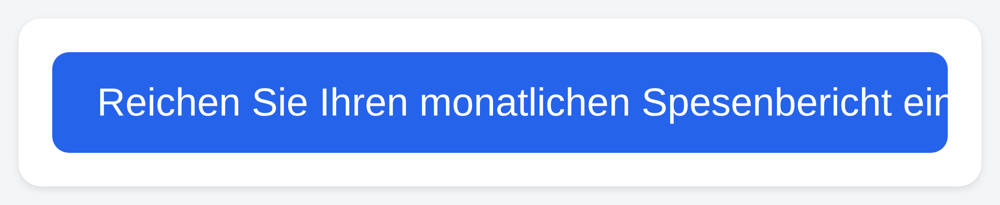
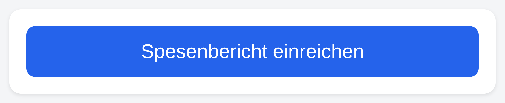

English version → [README.md](README.md)

# translate-robot

Traduit les nouvelles chaînes d'interface sous la contrainte réelle de
largeur rendue de leur composant — pas une estimation au nombre de
caractères. Quand une traduction est trop longue pour le bouton, l'onglet
ou l'élément de navigation où elle s'affiche, translate-robot le détecte
avant la mise en production, pas après qu'un utilisateur l'ait signalé
par une capture d'écran.

[](https://github.com/fiaaaansoo/translate-robot/actions/workflows/ci.yml)
[](LICENSE)

| Avant — traduction naïve | Après — translate-robot |
| --- | --- |
|  |  |
| `"Reichen Sie Ihren monatlichen Spesenbericht ein"` — allemand correct, trop large pour le bouton. | `"Spesenbericht einreichen"` — même sens, mesuré pour tenir. |

> Aucune clé API nécessaire pour voir ça marcher : `--dry-run` rejoue une
> traduction pré-enregistrée sur le repo-jouet fourni dans ce dépôt.

```bash
git clone https://github.com/fiaaaansoo/translate-robot.git && cd translate-robot
npm install && npm run build
node bin/translate-robot run --repo fixtures/toy-repo --recorded-translations fixtures/toy-repo/translations.recorded.json --target-locale de --dry-run
```

C'est exactement la configuration derrière les captures ci-dessus —
[`fixtures/toy-repo/`](fixtures/toy-repo/README.md) est un vrai composant
HTML et un vrai fichier i18n, pas une maquette.

translate-robot ouvre une pull request avec le résultat — il ne la merge
ni ne l'approuve jamais lui-même. Chaque traduction passe par une revue
humaine avant d'arriver en production, sans exception.

> **Les traductions sont une sortie de LLM.** translate-robot vérifie
> qu'une traduction tient dans son composant ; il ne vérifie pas qu'elle
> est correcte, complète ou culturellement appropriée. Faites toujours
> relire la pull request par quelqu'un qui lit la langue cible avant de
> merger. Voir [SECURITY.md](SECURITY.md).

---

## Comment la largeur est mesurée

La plupart des outils i18n estiment si une traduction va tenir en
comptant les caractères. Ça ne fonctionne pas bien : l'allemand et le
finnois sont 20 à 35 % plus longs que l'anglais à sens égal, les
caractères CJK sont plus larges que les caractères latins, et les
polices à chasse variable font que deux chaînes de même longueur peuvent
se rendre à des largeurs très différentes.

translate-robot mesure au lieu de deviner : il rend le vrai composant
dans un Chromium headless (via Playwright), insère chaque candidat de
traduction, et compare le `scrollWidth` du nœud à son `clientWidth` —
exactement ce qu'un vrai navigateur montrerait à un vrai utilisateur. Si
une traduction déborde, elle repart vers le LLM avec ce retour
(`"ce candidat dépassait de 23px, réessaie"`) pour un nombre borné de
tentatives.

## Installation

```bash
git clone https://github.com/fiaaaansoo/translate-robot.git
cd translate-robot
npm install
npm run build
```

Node.js ^22.12.0 (ou ^24, ou >=26) est requis. `npm install` installe
aussi Playwright ; son binaire Chromium peut nécessiter un
`npx playwright install chromium` séparé selon l'environnement.

## Usage

```bash
node bin/translate-robot run \
  --new-i18n i18n/en.json \
  --mapping i18n-map.json \
  --target-locale de \
  --owner <propriétaire-github> \
  --repo-name <nom-du-repo-github>
```

Ceci diffe `i18n/en.json` contre sa version sur la branche de base,
traduit chaque clé ajoutée ou modifiée sous la contrainte de largeur
mesurée de son composant, écrit le résultat dans `i18n/de.json`, et ouvre
une pull request. Ajoutez `--dry-run` pour voir le résultat sans rien
écrire ni ouvrir de PR — utile en CI, ou pour vérifier un run avant qu'il
ne touche votre dépôt.

Lancez `node bin/translate-robot run --help` pour la liste complète des
options (chemin du catalogue source, branche de base, borne de
tentatives, et plus).

Par défaut, les traductions viennent de l'API Anthropic
(`ANTHROPIC_API_KEY` dans l'environnement) ; le token GitHub utilisé pour
pousser la branche et ouvrir la PR vient de `GITHUB_TOKEN`. Ni l'un ni
l'autre n'est jamais loggué ni inclus dans un message d'erreur. Envoyer
des chaînes source à l'API Anthropic signifie qu'elles sont traitées par
ce sous-traitant tiers via votre propre clé API — translate-robot n'est
pas un service hébergé, vous restez donc responsable du traitement de ce
que vous lui envoyez.

## GitHub Action

```yaml
name: translate-robot
on:
  pull_request:
    paths: ['i18n/en.json']

permissions:
  contents: write
  pull-requests: write

jobs:
  translate:
    runs-on: ubuntu-latest
    steps:
      - uses: actions/checkout@v4
      - uses: fiaaaansoo/translate-robot@v1
        with:
          target-locale: de
          github-token: ${{ secrets.GITHUB_TOKEN }}
          anthropic-api-key: ${{ secrets.ANTHROPIC_API_KEY }}
```

Le bloc `permissions` ci-dessus est le minimum nécessaire à l'Action —
`contents: write` pour pousser la branche de traduction,
`pull-requests: write` pour ouvrir la PR. Donnez le même scope à tout
jeton que vous configurez ; il n'a jamais besoin d'accès `admin`.

## Périmètre v1

La v1 résout un pipeline complet plutôt que plusieurs à moitié. Limites
actuelles, toutes volontaires :

- Une langue source, une langue cible : anglais vers allemand.
- Catalogues i18n JSON plats uniquement — pas de clés imbriquées, pas de
  règles de pluriel ICU, pas d'autre format (Fluent, gettext, etc.).
- Un seul moteur de rendu : Chromium, via Playwright.
- Une pull request par run.

Pas encore construit : langues cibles supplémentaires, catalogues
imbriqués/structurés, autres moteurs de rendu, regroupement de plusieurs
runs dans une seule PR.

Sans rapport avec le périmètre v1 et qui ne changera pas :
translate-robot ne merge ni n'approuve jamais une pull request lui-même.
Chaque traduction passe par une revue humaine avant d'arriver en
production, en v1 comme après.

## Contribuer

Voir [CONTRIBUTING.md](CONTRIBUTING.md) pour les conventions de
branches/commits et [CODE_OF_CONDUCT.md](CODE_OF_CONDUCT.md) pour les
standards de la communauté. Les problèmes de sécurité passent par
[SECURITY.md](SECURITY.md), pas par une issue publique.

## Licence

[Apache License 2.0](LICENSE).
